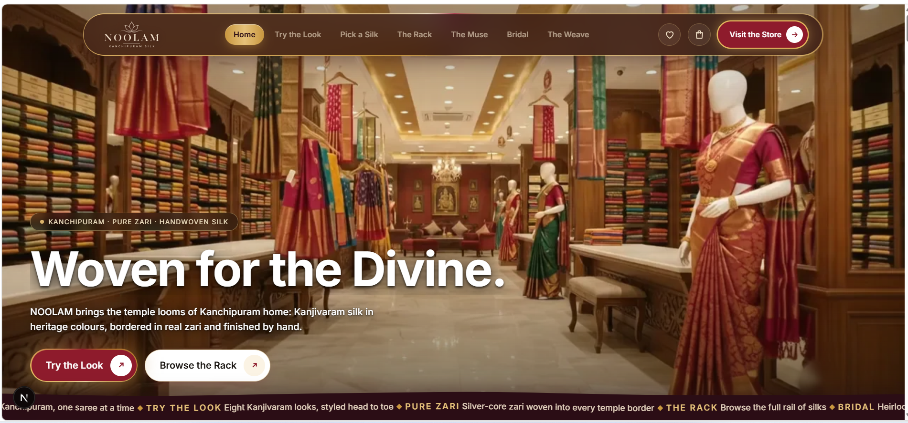
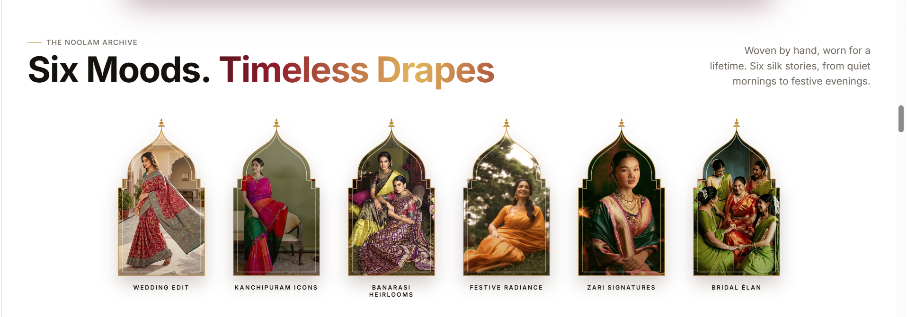
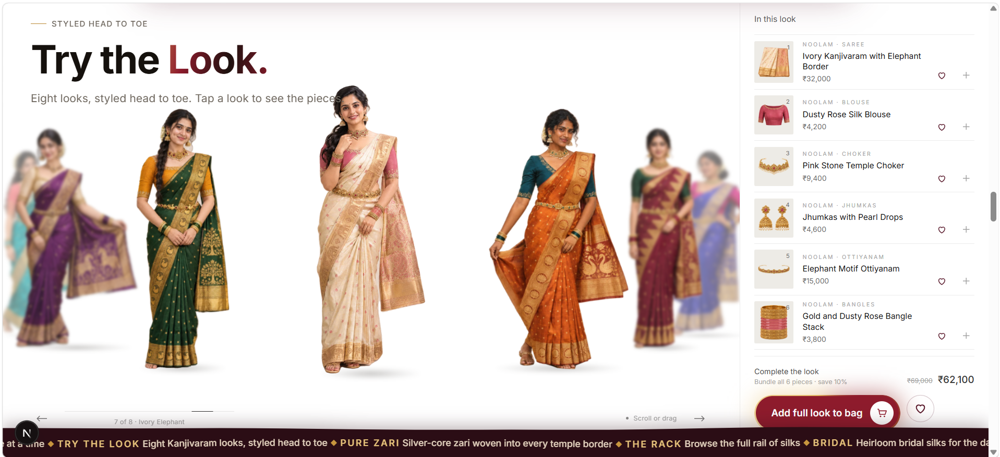
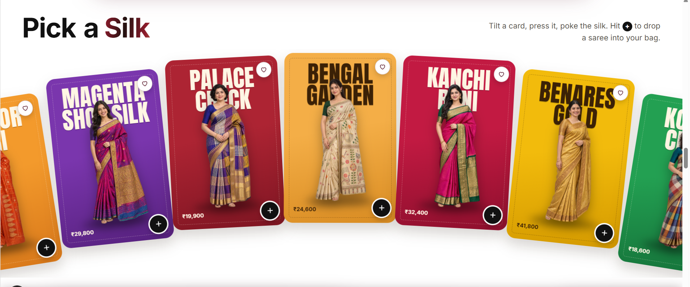
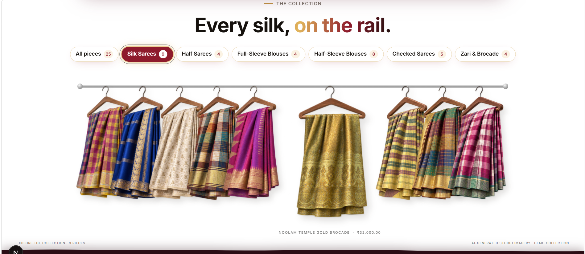
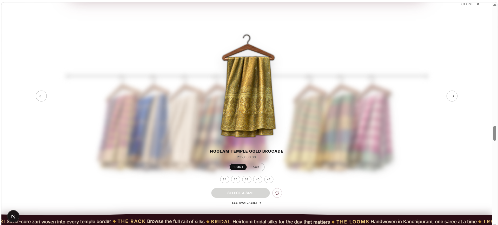
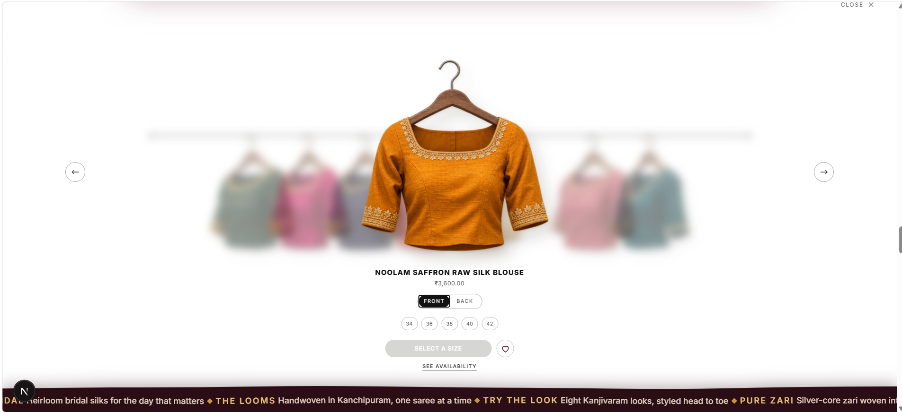
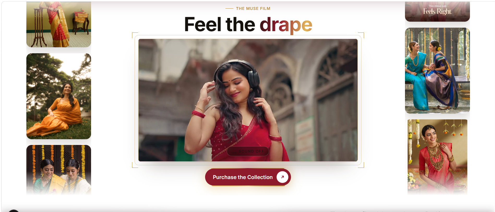
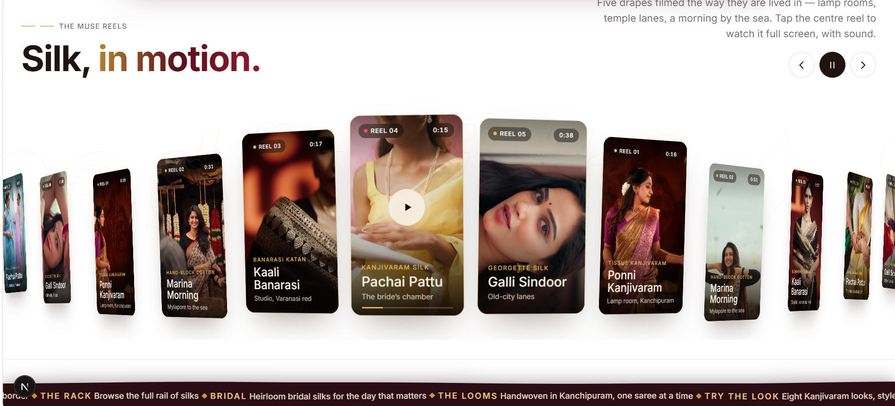
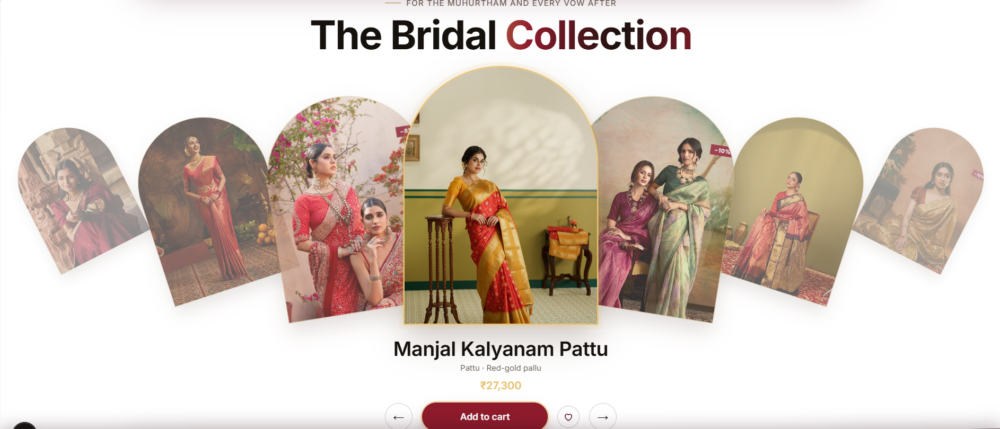

# NOOLAM — Kanchipuram Silk Saree Website

A showcase website for a fictional Kanchipuram silk house, built from the ten
reference screens in [`screenshots/`](screenshots). Dark maroon, temple gold and
ivory, gopuram arches, a saree rail you can lift pieces off, and a bridal
archive.

<p>
  
  
  
  
  
  
  
  
  
  
</p>

## Run it

```bash
npm install
npm run dev          # http://localhost:3000
```

Production checks:

```bash
npm run typecheck    # tsc --noEmit
npm run build        # static build, one page per product
npm start
```

## Routes

| Route | What it is |
| --- | --- |
| `/` | The full showcase: hero, archive, try-the-look, pick-a-silk, the rack, muse film, muse reels, bridal carousel, footer |
| `/shop` | All 25 pieces with filter pills and sorting |
| `/product/[slug]` | Product page — front/back drape, size, quantity, add to bag, care notes, related pieces |
| `/bridal` | The seven-piece bridal archive, promises and appointment booking |
| `/care` | Shipping, returns, silk care, blouse sizes, visit us and the enquiry form |
| `/compare` | Up to three pieces side by side: price, weave, pallu, colour, stock, sizes |

## Motion and smoothness

- **Smooth scrolling** with [Lenis](https://lenis.darkroom.engineering/) on
  desktop wheel and trackpad. Touch scrolling stays native, and Lenis is not
  started at all for visitors who prefer reduced motion
  (`components/motion/smooth-scroll.tsx`).
- **Scroll-driven scenes** built on motion values, never React state per frame:
  - the hero closes into a gold temple arch as you scroll;
  - the loom story weaves a saree in four steps;
  - Try the Look, Pick a Silk and the Rack are pinned rails.
- **CSS scroll timelines** for lighter touches (`.sd-rise`, `.sd-mask`,
  `.sd-line`, `.sd-parallax` in `app/globals.css`). They run off the main
  thread; browsers without support show the content in place.
- **Route transitions** use React's `<ViewTransition>`: a maroon curtain between
  pages, and the saree you click carries across into its product page.
- **First-visit preloader**: a gold thread and the wordmark, in pure CSS, once
  per browser session.
- Every effect has a complete, static reduced-motion version.

## Shopping features

- **Search** with ⌘K / Ctrl+K or the header icon. It searches sarees, blouses,
  looks and bridal pieces by name, colour, weave and category.
- **Quick view** from any card in the shop, without leaving the grid.
- **Compare** up to three pieces from the cards, then open `/compare`.
- **Recently viewed** pieces on product pages and in the empty search box.

## How orders and enquiries reach the shop

> Running the shop? Start with the [owner guide](docs/OWNER-GUIDE.md).

- **Orders go to WhatsApp.** The bag's "Order on WhatsApp" button opens a chat
  with the shop, the item list and subtotal already written. The shop confirms
  stock and delivery, then sends a payment link. There is no online payment.
- **Enquiries go by email, with WhatsApp as a fallback.** The care-page form,
  "See it on a video call", "Book a fitting" and "Email this order" all use the
  server action in `app/actions/enquiry.ts`. With `RESEND_API_KEY` set it emails
  the shop; without it, the visitor gets a WhatsApp button with the same
  message, so nothing is lost.
- **The bag and wishlist survive a refresh** (saved in the browser).
- **Stock is set per piece** in `lib/data.ts` (`stock`, `madeToOrder`) and shows
  as "Only 1 left", "Sold out" or "Made to order".
- **Shop details live in one file**, `lib/shop.ts`: WhatsApp number, phone,
  address, hours, shipping and returns. The site, the emails and the Google
  listing (JSON-LD, sitemap, robots) all read from it.

## What is still a demo

- **Product imagery is procedural.** Every saree and blouse is drawn with CSS
  gradients, zari/check/buta patterns and SVG clip-paths in
  `components/site/silk-fabric.tsx`. Replace it with real photos before launch.
- **Atmosphere photography is free stock**, kept locally in
  `public/images/editorial/`. See [`docs/IMAGES.md`](docs/IMAGES.md) for the
  swap guide and credits.
- **Placeholder shop details.** The phone, WhatsApp number, address and email in
  `lib/shop.ts` are examples.
- The footer newsletter form shows a toast only.

## Structure

```text
app/
  page.tsx                 home composition
  shop/page.tsx            catalog page
  product/[slug]/page.tsx   product page (generateStaticParams)
  bridal/page.tsx          bridal archive
  care/page.tsx            shipping, returns, sizes, visit us, enquiry form
  actions/enquiry.ts       server action that emails enquiries
  compare/page.tsx         side-by-side comparison
  sitemap.ts, robots.ts    search engine files
  globals.css              Tailwind v4 tokens + typography utilities
components/
  motion/                  smooth scroll, split headlines, page transitions
  site/                    all store sections and storefront UI
  ui/                      small shadcn-style primitives
lib/
  data.ts                  single typed source for the catalog (and stock)
  shop.ts                  shop details: contact, hours, shipping, returns
  whatsapp.ts              prefilled WhatsApp messages
  structured-data.ts       Google listing data (JSON-LD)
  utils.ts                 cn() and INR formatting
public/images/editorial/   stock photography used for atmosphere
screenshots/               the ten design references
```

Design tokens live in `app/globals.css`: maroon, gold, ivory, cream, sand, ink.
Poppins is loaded through `next/font` and exposed as `--font-poppins`.

## Editing the catalog

Everything the storefront renders comes from `lib/data.ts`:

- `products` — the 25 sarees and blouses (prices, fabrics, sizes, swatches).
- `looks` — the eight styled looks and their pieces.
- `bridal` — the seven bridal pieces.
- `reels`, `moods`, `tickerItems`, `navLinks`.

Adding a product automatically adds its product page (`generateStaticParams`)
and its slot in the rack and shop filters. Keep the category counts in the
reference intact if you are matching the design.

## Credits

References: the ten supplied screenshots. Font: Poppins (SIL Open Font
License). Icons: [Lucide](https://lucide.dev). Stock photography: Unsplash free
license — details in [`docs/IMAGES.md`](docs/IMAGES.md).

Process notes: [PROMPTS.md](PROMPTS.md) · [HOW-WE-MADE.md](HOW-WE-MADE.md)
