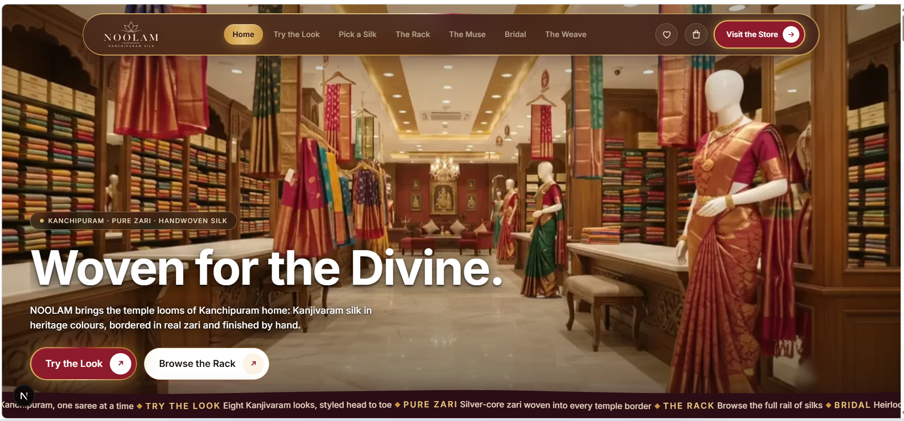
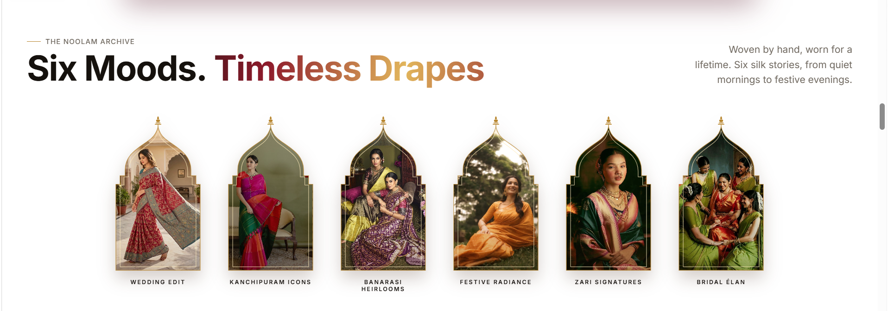
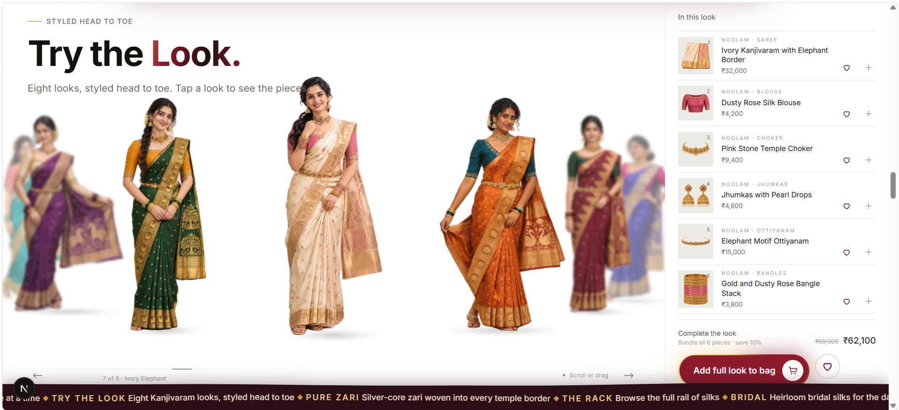
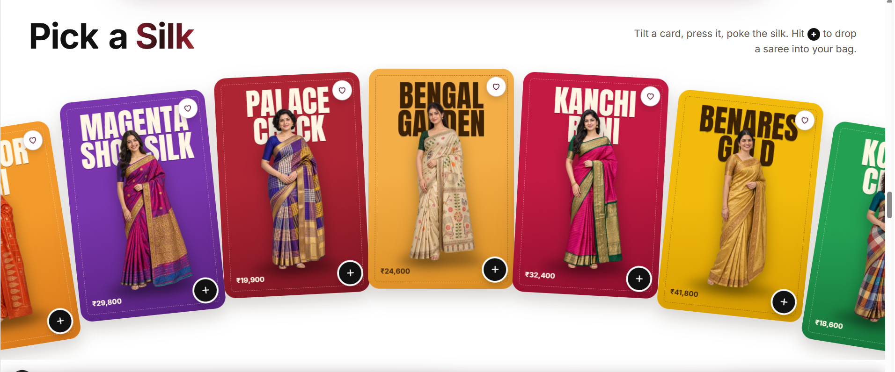
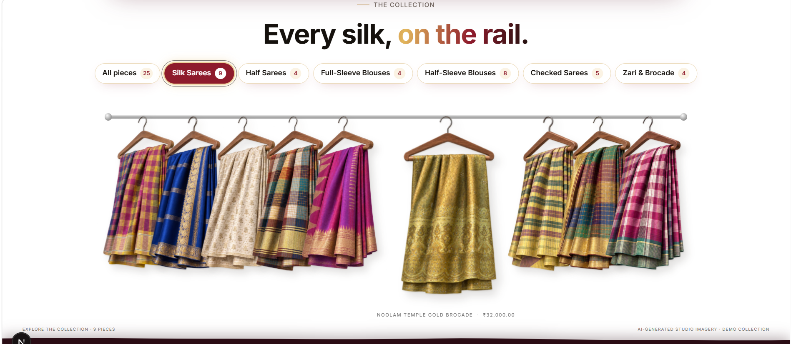
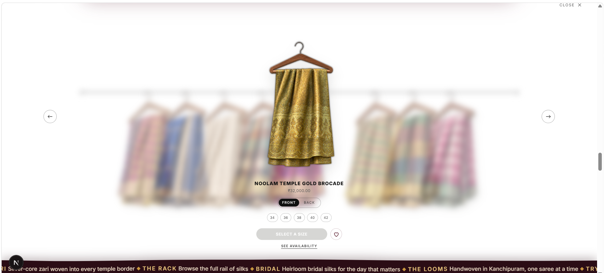
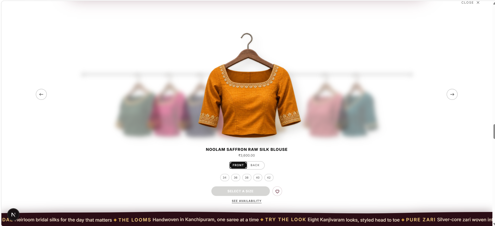
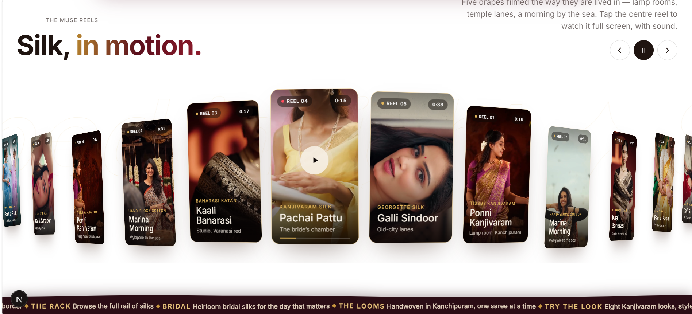
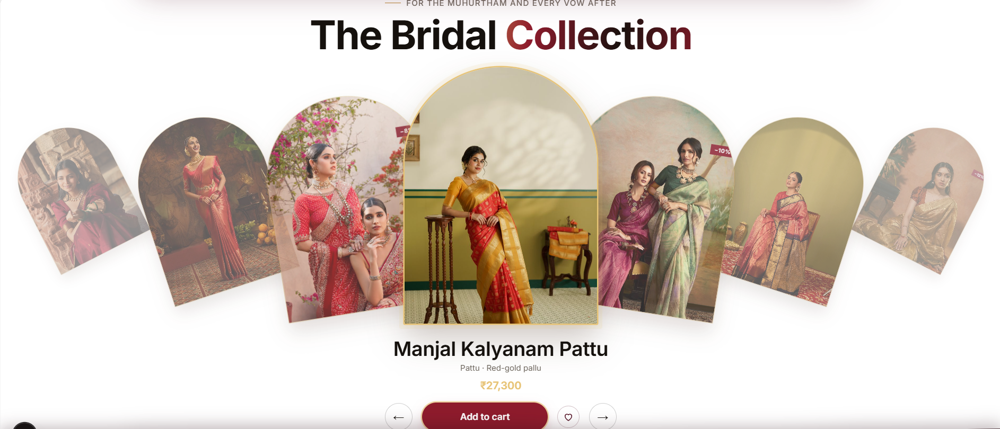

# NOOLAM — Kanchipuram Silk Saree Website

A heritage saree showroom website (dummy brand) built with Claude Code. Each section below shows the prompt used and the result.

| Prompt | Screenshot |
|---|---|
| **Hero** — Build a divine heritage showroom hero with a glass nav, the headline "Woven for the Divine.", two CTAs and a scrolling gold ticker. |  |
| **Six Moods** — Show six saree moods inside golden temple-arch frames with a gradient headline "Six Moods. Timeless Drapes". |  |
| **Try the Look** — Create a drag carousel of eight styled models with an "In this look" panel listing every piece and an "Add full look to bag" bundle. |  |
| **Pick a Silk** — Make a fanned arc of bold colourful saree cards you can tilt, press and add to bag with a plus button. |  |
| **The Rack** — Put every silk on a clothes rail with hangers and category filter chips like a real store rack. |  |
| **Rack detail (saree)** — When a hanger is clicked, lift it forward, blur the rail and show name, price, front/back and sizes. |  |
| **Rack detail (blouse)** — Same lift-off detail view for blouses, with arrows to move along the rail. |  |
| **The Muse Film** — Centre a framed brand film "Feel the drape" with scrolling photo columns on both sides and a purchase button. |  |
| **The Muse Reels** — Build a 3D curved reel carousel "Silk, in motion." with play controls and tap-to-watch full screen. |  |
| **Bridal Collection** — Show bridal sarees in arched cards on a curved carousel with name, price and Add to cart. |  |

See [HOW-WE-MADE.md](HOW-WE-MADE.md) for the process.
